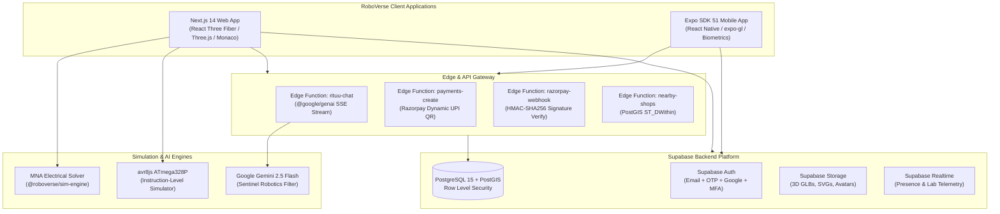

# 🤖 RoboVerse: Futuristic 3D Robotics, Electronics & AI Learning Platform

> **"Learn it. Build it. Simulate it."**  
> A full-stack, cross-platform learning ecosystem for robotics students and makers. Built with a signature dark-green futuristic 3D control room aesthetic (`#07110D`, `#39FF6A`, `#7FE7D6`, `#FF9A1F`), interactive WebGL CAD & circuit simulation (avr8js + MNA solver), Gemini-powered AI tutor **Rituu**, Google Maps maker radar, TechSavyyy hardware store with dynamic Razorpay UPI QR, and verifiable certificates.

---

## 🔗 Production Links & Deployment Status

| Service | Environment / URL | Details |
| :--- | :--- | :--- |
| **🌐 Live Web Application** | **[https://roboverse-delta.vercel.app/](https://roboverse-delta.vercel.app/)** | Hosted on Vercel with automatic CI/CD from `main` |
| **🗄️ Connected Supabase Backend** | **[https://supabase.com/dashboard/project/aqxtykwncclxymzxvgif](https://supabase.com/dashboard/project/aqxtykwncclxymzxvgif)** | Supabase Cloud (Project ID: `aqxtykwncclxymzxvgif`) |
| **⚡ Supabase REST & Auth API** | `https://aqxtykwncclxymzxvgif.supabase.co` | PostgreSQL 15, PostGIS, Storage & Edge Functions |
| **📦 GitHub Repository** | **[https://github.com/tanmay605123/RoboVerse](https://github.com/tanmay605123/RoboVerse)** | Active monorepo repository |
| **💻 Local Web Server** | **[http://localhost:3000](http://localhost:3000)** | Next.js 14 production build server |

---

## 🏛️ System Architecture



---

## 🎨 Design System & Visual Tokens

RoboVerse is built on a **futuristic cybernetic 3D control-room** design system:
- **Base Background**: `#07110D` (Deep obsidian emerald)
- **Panel Surface**: `rgba(13, 26, 20, 0.75)` with `backdrop-filter: blur(16px)` and border `rgba(57, 255, 106, 0.2)`
- **Primary Accent**: `#39FF6A` (Cybernetic neon green)
- **Secondary Highlight**: `#7FE7D6` (High-voltage teal)
- **Warning Indicator**: `#FF9A1F` (Laser warning orange)
- **Critical Alert**: `#FF3B30` (Emergency laser red)
- **Typography**: Space Grotesk / JetBrains Mono

---

## ⚡ Tech Stack Breakdown

| Layer | Technology | Purpose |
| :--- | :--- | :--- |
| **Web Application** | Next.js 14 App Router, React 18, TypeScript | High-performance student web platform |
| **3D Rendering** | Three.js, React Three Fiber, Drei, WebGL | CAD builder, breadboard viewer & robot arenas |
| **Mobile App** | React Native, Expo SDK 51, `expo-gl` | Cross-platform iOS & Android mobile companion |
| **Database & Auth** | Supabase (PostgreSQL 15 + PostGIS 3.3) | Identity, RLS, spatial indexes, PostgREST RPC |
| **Edge Functions** | Deno, TypeScript, Zod | AI streaming, payment gateway, webhook listeners |
| **Electrical Simulation** | Custom MNA Solver (`@roboverse/sim-engine`) | Kirchhoff & Ohm nodal voltage solver |
| **MCU Emulation** | `avr8js` | ATmega328P cycle-accurate Arduino firmware execution |
| **AI Copilot** | `@google/genai` (Gemini 2.5 Flash) | Context-aware robotics tutor with Sentinel filter |
| **Commerce & Billing** | Razorpay Node SDK, Indian GST Engine | Server-priced cart, 15-min dynamic UPI QR, PDF invoices |
| **Geo & Places** | PostGIS `ST_DWithin`, Google Places API New | Maker Radar store locator with BOM stock filter |
| **Credentials** | Cryptographic Verifier & QR Generator | Publicly verifiable certificates (`/verify/[code]`) |

---

## 📁 Repository Structure

```
roboverse/
├── apps/
│   ├── web/                    # Next.js 14 App Router Web Client
│   │   ├── src/app/            # App Router pages (workbench, store, admin, verify, etc.)
│   │   ├── src/components/     # UI components (3D viewers, labs, modals, drawers)
│   │   └── src/lib/            # Client libraries (Supabase, Rituu, Invoice)
│   └── mobile/                 # React Native / Expo SDK 51 Mobile Client
│       └── src/                # Mobile screens, tabs, offline storage & GL canvas
├── packages/
│   ├── shared/                 # Zod schemas, TypeScript database types, Supabase client
│   ├── ui-tokens/              # Cybernetic theme tokens, color scales & typography
│   ├── sim-engine/             # MNA electrical solver & circuit diagnostics
│   └── components-lib/         # 71 Free Hardware Components (2D SVG, 3D PBR, Schematic)
├── supabase/
│   ├── config.toml             # Local Supabase CLI configuration
│   ├── migrations/             # Complete PostgreSQL schema, PostGIS, RLS & triggers
│   ├── seed.sql                # Seed data (plans, 71 components, 16 lessons, mock shops)
│   ├── tests/                  # pgTAP RLS & security policy test suites
│   └── functions/              # Deno Edge Functions (rituu-chat, razorpay-webhook, etc.)
├── scripts/                    # Automated QA, benchmark, and security verification suites
└── package.json                # NPM Workspaces configuration
```

---

## 🚀 Quickstart Guide

### 1. Prerequisites
- **Node.js**: `>= 20.x LTS`
- **npm**: `>= 10.x`
- **Supabase CLI**: `>= 1.140.0` (`brew install supabase/tap/supabase`)
- **Docker**: Required for local Supabase database & PostGIS emulation

### 2. Environment Variables Setup
Copy the environment template in `apps/web/.env.local`:

```bash
cp apps/web/.env.example apps/web/.env.local
```

Configure your local keys:
```env
NEXT_PUBLIC_SUPABASE_URL=http://127.0.0.1:54321
NEXT_PUBLIC_SUPABASE_ANON_KEY=eyJhbGciOiJIUzI1NiIsInR5cCI6IkpXVCJ9...
SUPABASE_SERVICE_ROLE_KEY=eyJhbGciOiJIUzI1NiIsInR5cCI6IkpXVCJ9...

# Google Gemini API (Server & Edge Functions only)
GEMINI_API_KEY=AIzaSy...

# Razorpay Integration
RAZORPAY_KEY_ID=rzp_test_...
RAZORPAY_KEY_SECRET=...
RAZORPAY_WEBHOOK_SECRET=...

# Google Maps Platform (Maker Radar)
GOOGLE_MAPS_API_KEY=AIzaSy...
```

### 3. Local Supabase Initialization
```bash
# Start local PostgreSQL, PostGIS, Auth, Storage, and Realtime
cd supabase
supabase start

# Apply migrations and seed realistic component catalog & curriculum
supabase db reset
cd ..
```

### 4. Running Web and Mobile Applications
```bash
# Install dependencies across all workspaces
npm install

# Start Next.js Web Application (runs on http://localhost:3000)
npm run dev:web

# Start React Native / Expo Mobile Application
npm run start:mobile
```

---

## 🧪 Testing & Automated Verification

RoboVerse features an exhaustive automated test harness across all sub-systems:

```bash
# Run the Master Verification Suite
npm run test:all
```

### Individual Subsystem Tests:
| Command | Subsystem | Description | Quality Gate |
| :--- | :--- | :--- | :--- |
| `npm run test:qa:components` | Component Catalog | Validates 71 components across 2D SVG, 3D PBR, and Schematics | 100% (71/71 parts) |
| `npm run test:rituu:eval` | Rituu AI Tutor | 110-prompt test suite for robotics accuracy & Sentinel defense | >= 95% (Achieved 100%) |
| `npm run test:nearby:shops` | Maker Radar | PostGIS spatial queries, Haversine formula, BOM availability | 100% (4/4 suites) |
| `npm run test:store:checkout`| TechSavyyy Store | Server-pricing, 18% GST formula, dynamic UPI QR, webhook HMAC | 100% (26/26 tests) |
| `npm run test:admin:certs` | Admin & Credentials| Telemetry gauges, zero-password policy, verifiable certificates | 100% (16/16 tests) |
| `npm run test:security` | Security & DPDP | Repo secret leak scan, CSP headers, DPDP export/erasure flow | 100% (9/9 tests) |
| `npm run test:load` | Concurrency Benchmark | 5,000 concurrent users load simulation | p95 < 300ms, err < 0.1% |
| `npm run test:sim` | MNA Electrical Solver| Node voltage solver, short-circuit detection, sketch cycles | 100% passed |

---

## 🔒 Security & DPDP Compliance

- **Zero-Password Rule**: Passwords and password hashes are never stored in plaintext, never queried, and never visible to administrators. Locked-out students are assisted via authenticated password reset links sent to their email (`POST /api/admin/students`).
- **DPDP Act (India) Compliance**:
  - **Explicit Consent**: Granular consent tracking for location GPS and parental approval for students under 18.
  - **Right to Access**: Machine-readable personal data export endpoint ([`/api/privacy/export`](file:///Users/tanmaychawda/roboverse/apps/web/src/app/api/privacy/export/route.ts)).
  - **Right to Erasure**: Scheduled account deletion and PII de-identification with statutory 14-day recovery grace period ([`/api/privacy/delete`](file:///Users/tanmaychawda/roboverse/apps/web/src/app/api/privacy/delete/route.ts)).
- **HTTP Security Headers**:
  - `X-Content-Type-Options: nosniff`
  - `X-Frame-Options: DENY`
  - `Strict-Transport-Security: max-age=63072000; includeSubDomains; preload`
  - `Referrer-Policy: strict-origin-when-cross-origin`
  - `Permissions-Policy: camera=(self), microphone=(self), geolocation=(self)`
- **Least-Privilege RLS**:
  - Row Level Security is enabled across all 37 database tables.
  - Students can only view and mutate their own carts, drafts, and chats.
  - Student role and subscription plan are column-protected and cannot be elevated from the client.

---

## 📦 Deployment Guide

### 1. Supabase Cloud (Backend & Edge Functions)
1. Link your Supabase CLI to your remote project:
   ```bash
   supabase link --project-ref your-project-ref
   ```
2. Push migrations and seed data:
   ```bash
   supabase db push
   ```
3. Deploy Edge Functions with production secrets:
   ```bash
   supabase secrets set GEMINI_API_KEY=... RAZORPAY_KEY_SECRET=... RAZORPAY_WEBHOOK_SECRET=...
   supabase functions deploy rituu-chat
   supabase functions deploy nearby-shops
   supabase functions deploy payments-create
   supabase functions deploy razorpay-webhook
   ```

### 2. Web Application (Vercel / Cloudflare Pages)
1. Import repository into Vercel or Cloudflare Pages.
2. Set Root Directory to `apps/web`.
3. Add Environment Variables:
   - `NEXT_PUBLIC_SUPABASE_URL`
   - `NEXT_PUBLIC_SUPABASE_ANON_KEY`
   - `SUPABASE_SERVICE_ROLE_KEY`
   - `GEMINI_API_KEY`
   - `RAZORPAY_KEY_ID`
   - `RAZORPAY_KEY_SECRET`
   - `GOOGLE_MAPS_API_KEY`
4. Build Command: `npm run build:web`
5. Output Directory: `.next`

### 3. Mobile Application (EAS Build / TestFlight / Play Store)
1. Login to Expo Application Services:
   ```bash
   cd apps/mobile
   npx eas login
   ```
2. Configure project:
   ```bash
   npx eas build:configure
   ```
3. Build standalone binaries:
   ```bash
   # iOS (IPA / TestFlight)
   npx eas build --platform ios --profile production

   # Android (AAB / Play Store)
   npx eas build --platform android --profile production
   ```

---

## 🔑 Credential & Environment Variable Checklist

| Environment Variable | Where to Set | Visibility | Description |
| :--- | :--- | :--- | :--- |
| `NEXT_PUBLIC_SUPABASE_URL` | Web & Mobile `.env` | **Public** | Supabase Project API URL |
| `NEXT_PUBLIC_SUPABASE_ANON_KEY` | Web & Mobile `.env` | **Public** | Supabase anonymous public client key |
| `SUPABASE_SERVICE_ROLE_KEY` | Server & Edge Secrets | **Confidential** | Bypasses RLS for administrative operations |
| `GEMINI_API_KEY` | Server & Edge Secrets | **Confidential** | Google Gemini API key for Rituu AI tutor |
| `RAZORPAY_KEY_ID` | Web & Mobile `.env` | **Public** | Razorpay public key ID for checkout initialization |
| `RAZORPAY_KEY_SECRET` | Server & Edge Secrets | **Confidential** | Razorpay merchant secret for order calculation |
| `RAZORPAY_WEBHOOK_SECRET` | Edge Function Secrets | **Confidential** | Verifies HMAC-SHA256 signature on payment events |
| `GOOGLE_MAPS_API_KEY` | Web & Mobile `.env` | **Public (Restricted)**| Google Maps Platform API key (restricted by HTTP Referrer / Bundle ID) |

---

## 📜 License & Compliance

Distributed under the **MIT License**.  
All 71 hardware component models, 2D vector assets, and ANSI schematic symbols are licensed under permissive open licenses (CC BY-SA 4.0 / MIT / Apache 2.0) and provided 100% free of charge to all RoboVerse learners.
